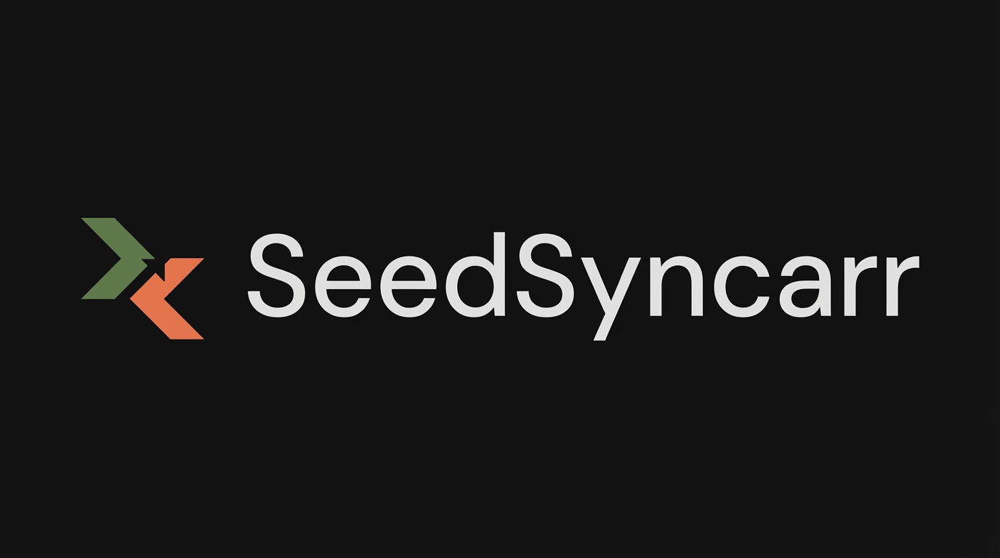
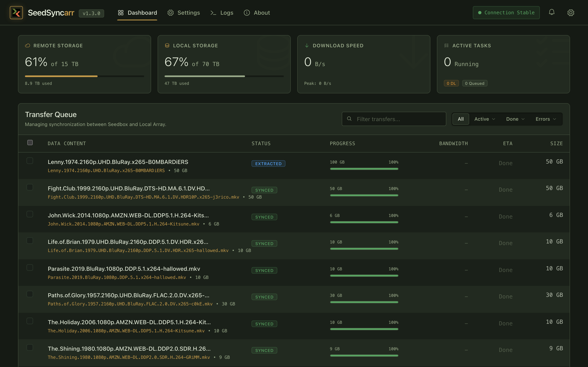

<p align="center">
  <picture>
    <source media="(prefers-color-scheme: dark)" srcset="doc/brand/wordmark-dark.png">
    <source media="(prefers-color-scheme: light)" srcset="doc/brand/wordmark-light.png">
    
  </picture>
</p>

<p align="center">
  
</p>

> A Sonarr-driven seedbox sync tool where optional auto-delete waits for Sonarr/Radarr to confirm the import.

[](https://github.com/thejuran/seedsyncarr/actions/workflows/ci.yml)
[](https://github.com/thejuran/seedsyncarr/releases)
[](https://github.com/thejuran/seedsyncarr/pkgs/container/seedsyncarr)
[](LICENSE)

## About This Fork

SeedSyncarr is a fork of [SeedSync](https://github.com/ipsingh06/seedsync) (ipsingh06). Like other active forks, it modernizes the original; SeedSyncarr's focus is a Sonarr-driven workflow in which optional local cleanup follows the import confirmation from Sonarr/Radarr (see [How It Works](#how-it-works)). SeedSyncarr is Sonarr/Radarr-driven, so it receives import webhooks from those services rather than pushing notifications outbound.

## Quick Start

```yaml
services:
  seedsyncarr:
    image: ghcr.io/thejuran/seedsyncarr:latest
    container_name: seedsyncarr
    restart: unless-stopped
    environment:
      - PUID=1000   # uid that owns your /config and /downloads host paths
      - PGID=1000   # gid that owns your /config and /downloads host paths
    ports:
      - "8800:8800"
    volumes:
      - ~/.seedsyncarr:/config
      - /path/to/downloads:/downloads
```

> **Set `PUID`/`PGID` to the owner of your mounted paths.** SeedSyncarr writes
> downloads to `/downloads`, so the container user must own (or be able to write)
> the host directory behind it. Find the right values on the host with `id`
> (e.g. `id $USER`). If `PUID`/`PGID` are omitted, the container defaults to
> `1000:1000`. A mismatch here is the most common cause of "files show as active
> but never download" — the container can't write the destination.

> **Network exposure.** Both examples publish port 8800 on all host interfaces,
> so the web UI, the API and the webhook endpoints are reachable from any network
> the host is on. For any untrusted network, put SeedSyncarr behind an
> authenticating reverse proxy and restrict network access to the port.
> `api_token` protects the API but not the UI, and the UI contains that token.
> See [Security](#security).

## Documentation

**Using SeedSyncarr**

- [Getting Started](docs/GETTING-STARTED.md) — prerequisites, installing with Docker Compose or `docker run`, first run and common setup issues
- [Configuration](docs/CONFIGURATION.md) — every `settings.cfg` option, required vs optional settings, CLI arguments and defaults
- [Security](SECURITY.md) — how to report a vulnerability, the security posture and deployment best practices

**Contributing / internals**

- [Architecture](docs/ARCHITECTURE.md) — system overview, component diagram, data flow and key abstractions
- [Development](docs/DEVELOPMENT.md) — local setup, build commands, code style, branch conventions and the PR process
- [Testing](docs/TESTING.md) — the pytest, Angular unit and Playwright end-to-end suites, how to run them, coverage and CI integration

## Features

- **LFTP-based transfers** — built on [LFTP](http://lftp.tech/) for fast transfers with parallel connections and segmented downloads
- **Web UI** — monitor and control all transfers from a clean, responsive dashboard
- **Auto-extraction** — automatically extract archives after sync completes
- **AutoQueue** — pattern-based file selection syncs only the files you want
- **Sonarr and Radarr integration** — import webhooks from Sonarr/Radarr confirm what reached your library, and optional cleanup can follow (see [How It Works](#how-it-works))
- **Local and remote file management** — browse, delete, and manage files on both ends from the UI
- **Docker packaging** — available as Docker images for amd64 and arm64
- **Dark mode** — full dark theme with earthy palette designed for always-on displays
- **Security controls** — always-on CSP headers; rate limiting on the Sonarr/Radarr webhook, POST config-set, test-connection, bulk-command and status endpoints; file names sanitized for CR/LF and control characters before they reach log lines; and an IP-resolution guard on Sonarr/Radarr URLs when testing a connection. Settings that are off until you configure them are listed under [Security](#security).

## How It Works

SeedSyncarr runs on your local server and connects to your remote seedbox over SSH. The LFTP sync engine transfers new files from the seedbox to your local machine as they appear, and can automatically extract archives once a transfer completes.

Sonarr and Radarr then import the synced files and call SeedSyncarr's inbound webhook endpoint; that call is the import confirmation. Cleanup after import is handled by Post-Import Pruning, which is optional and off by default. When enabled, it applies only to releases SeedSyncarr itself downloaded: after a confirmed import and a safety delay (default 60 seconds), SeedSyncarr attempts to delete the local copy, subject to completion and import safeguards. Deletion is deferred, and can eventually be given up, while a release is still extracting or a pack is only partly downloaded or imported (details in [Configuration](docs/CONFIGURATION.md)). A dry-run option logs what would be deleted without deleting anything. Pruning deletes the local copy only; the remote copy on the seedbox is not deleted by it.

Webhook calls are not verified by default; see [Security](#security) for what that means.

You don't need to install anything on the remote server — just SSH credentials.

## Installation

### Docker (recommended)

Pull and run with Docker Compose (see Quick Start above), or run directly:

```bash
docker run -d \
  --name seedsyncarr \
  --restart unless-stopped \
  -p 8800:8800 \
  -e PUID=1000 \
  -e PGID=1000 \
  -v ~/.seedsyncarr:/config \
  -v /path/to/downloads:/downloads \
  ghcr.io/thejuran/seedsyncarr:latest
```

Set `PUID`/`PGID` to the uid/gid that owns the host paths mounted at `/config`
and `/downloads` (run `id` on the host to find them; defaults to `1000:1000`).
The container remaps its user to these at start and fixes ownership of the
mount roots, so it can write your downloads.

### pip

Install system dependencies first, then install via pip:

```bash
# Runtime tools (Debian/Ubuntu)
sudo apt install lftp openssh-client p7zip-full unrar bzip2

# Build dependencies for the cryptography wheel (needed on systems
# without a prebuilt wheel for your Python version)
sudo apt install build-essential libssl-dev libffi-dev

# Install SeedSyncarr
pip install seedsyncarr

# Run
seedsyncarr
```

Requires Python 3.11 or 3.12.

For detailed setup instructions, see [Getting Started](docs/GETTING-STARTED.md) and [Configuration](docs/CONFIGURATION.md).

## Configuration

After starting SeedSyncarr, open `http://localhost:8800` in your browser.

Key configuration areas in **Settings**:

- **Remote Server** — SSH host, port, username, and path to sync from
- **Local Path** — where files are downloaded to on your local machine
- **Sonarr / Radarr** — webhook URLs and API keys for automated media imports
- **AutoQueue** — define patterns to automatically queue matching files for sync

## Usage Examples

**Sync only TV shows and movies using AutoQueue patterns**

In Settings, enable AutoQueue and turn on "Restrict to patterns". Add glob patterns to match
only the directories you want synced automatically:

```
TV Shows/*
Movies/*
```

Any new file on the remote server whose path matches a pattern is queued for sync without
manual intervention. Files that do not match are left on the remote server untouched.

**Confirm a Sonarr import before cleaning up**

In Settings, enable Sonarr and enter your Sonarr URL and API key. SeedSyncarr exposes an
inbound webhook endpoint at:

```
http://<seedsyncarr-address>:8800/server/webhook/sonarr
```

Add this URL as a webhook in Sonarr (Settings > Connect > Webhook) with the "On Import"
event selected. Sonarr then calls this endpoint after it imports an episode into your
library, and SeedSyncarr treats that incoming call as confirmation the file made it in —
the confirmation Post-Import Pruning waits for. Webhook calls are not verified by default
(see [Security](#security)). The same pattern applies to Radarr using the
`/server/webhook/radarr` endpoint.

**Automatically clean up after import**

Enable Post-Import Pruning in Settings. Once Sonarr or Radarr confirms an import, SeedSyncarr
waits for the configured safety delay (default: 60 seconds) and then attempts to delete the
local copy from the downloads directory, subject to its completion and import safeguards. Enable dry-run mode first to verify which files would be removed
before committing to automatic deletion.

## Screenshots

The dashboard — live transfers, sync progress, storage stats, and controls:

<p align="center">
  
</p>

## Related Projects

- [**Triggarr**](https://github.com/thejuran/triggarr) — lightweight search automation daemon for Radarr, Sonarr, and Lidarr. SeedSyncarr handles the download-to-sync side; Triggarr handles the search-to-trigger side.

## Contributing

See [CONTRIBUTING.md](CONTRIBUTING.md) for guidelines.

## Security

These protections are off until you configure them in `settings.cfg` (Docker: `/config/settings.cfg`):

- **API authentication** is off while `api_token` is empty. Even when it is set, three
  routes are exempt from the Bearer check: the webhook endpoints, the health check
  (`/server/status`) and the live event stream (`/server/stream`). The stream carries the
  application log and the full seedbox and local file list, so anyone who can reach port
  8800 can read them with or without `api_token`.
- **Webhook verification** is off while `webhook_secret` is empty, so anything that
  can reach the endpoint can report an import.
- **`webhook_require_secret`** defaults to `False`; on its own that value rejects nothing.
- **Encryption at rest** is off by default: stored secrets (seedbox password, API keys,
  tokens) are plaintext unless `[Encryption] enabled = True` is set.

Webhook verification requires a sender that signs each request: SeedSyncarr checks an
HMAC-SHA256 of the request body in the `X-Webhook-Signature` header. Sonarr and Radarr do
not sign their webhooks; they send only fixed custom headers or basic auth. With a direct,
unsigned Sonarr/Radarr webhook, a configured `webhook_secret` rejects each call (401), and
`webhook_require_secret = true` with no secret set rejects every call (503). In both cases
imports are no longer confirmed and pruning stops, so nothing is deleted. For direct
Sonarr/Radarr webhooks the practical protection is restricting who can reach port 8800. A
forged import can only lead to a deletion when pruning is enabled and the name matches a
release SeedSyncarr downloaded, and even then only the local copy is affected.

See [SECURITY.md](SECURITY.md) for reporting vulnerabilities and the full security posture.

## License

Apache License 2.0 — see [LICENSE](LICENSE).
